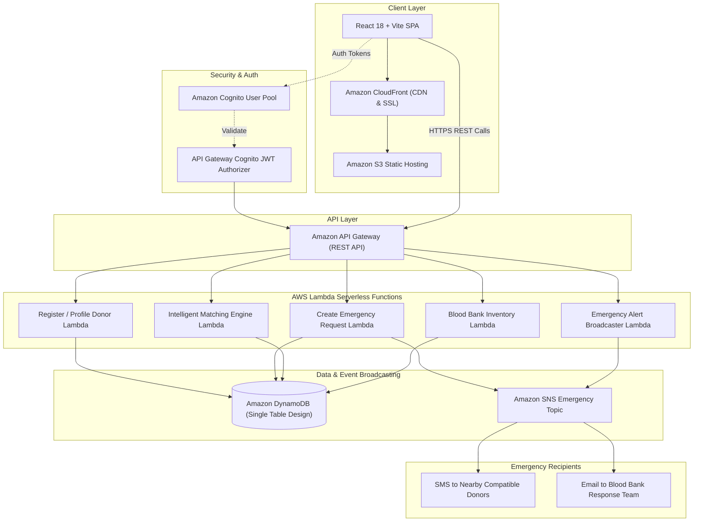

# SmartBlood 🩸
### Intelligent Serverless Blood Donation Network
**AWS Weekend Challenge – No Pipeline, No Problem**

---

## 📌 Executive Summary

Every two seconds, someone in the world needs blood. In critical emergencies—such as road trauma, acute surgical hemorrhages, and pediatric emergencies—finding compatible blood donors within minutes can mean the difference between life and death. Traditional blood banks often suffer from fragmented communication, manual telephone outreach, and outdated inventory lists.

**SmartBlood** solves this challenge by deploying a high-speed, intelligent, serverless blood donation network on AWS. When a medical team broadcasts an emergency need, SmartBlood's serverless matching engine automatically:
1. Evaluates biological compatibility across the universal blood type matrix.
2. Calculates real-time spherical distances (Haversine formula) to locate active, proximate donors.
3. Dispatches immediate notifications via **Amazon SNS** (SMS & Email).
4. Provides full inventory telemetry using a high-performance **Amazon DynamoDB Single-Table Design**.

All of this is accomplished with **zero persistent server infrastructure**, incurring $0 in idle compute costs and operating well within the **AWS Free Tier**.

---

## 🏗️ Architecture Overview

The SmartBlood platform is built completely on AWS Serverless architecture:



---

## 🛠️ Technology Stack

| Layer | Technology | Role & Advantage |
| :--- | :--- | :--- |
| **Frontend** | React 18 + Vite | Blazing fast client, modern modular components, zero build overhead |
| **Icons & UI** | Lucide React | Crisp, accessible healthcare iconography |
| **Backend Compute** | AWS Lambda (Node.js 20.x, ARM64) | Microsecond cold starts, automated scaling, zero server maintenance |
| **API Management** | Amazon API Gateway | REST endpoints, CORS negotiation, payload validation & rate limiting |
| **Database** | Amazon DynamoDB | Sub-10ms response times, Single-Table design, On-Demand billing |
| **Authentication** | Amazon Cognito | Secure user signup/signin, role-based access, JWT validation |
| **Notifications** | Amazon SNS | High-throughput pub/sub for emergency SMS and email broadcasting |
| **Hosting & CDN** | Amazon S3 + Amazon CloudFront | Global edge distribution, SSL termination, 99.99% availability |
| **Infrastructure as Code** | AWS SAM (Serverless Application Model) | Declarative cloud definitions with reproducible environments |

---

## 📂 Project Directory Structure

```
AWS/
├── .gitignore                      # Security-first gitignore (credentials, .env protection)
├── .env.example                    # Global environment variables example
├── README.md                       # Master project overview & architecture
├── docs/                           # Architectural and operational documentation
│   ├── architecture.md             # Detailed AWS architecture & component specifications
│   ├── api-specs.md                # REST API endpoint documentation & contracts
│   └── dynamodb-schema.md          # DynamoDB Single Table Design & access patterns
├── backend/                        # Serverless backend microservices
│   ├── .env.example                # Backend-specific environment variables
│   ├── package.json                # Dependencies (@aws-sdk v3, aws-jwt-verify)
│   ├── template.yaml               # AWS SAM template defining entire serverless stack
│   └── src/
│       ├── handlers/               # AWS Lambda entry points
│       │   ├── donors/             # Register & retrieve donor handlers
│       │   ├── requests/           # Create & list emergency request handlers
│       │   ├── matching/           # Intelligent donor-recipient matching handler
│       │   ├── notifications/      # SNS broadcast dispatcher handler
│       │   └── bloodBanks/         # Hospital inventory management handlers
│       ├── services/               # Core business logic
│       │   ├── donorService.js     # Donor management and status queries
│       │   ├── requestService.js   # Emergency request workflow
│       │   ├── matchingService.js  # Haversine distance & blood compatibility algorithm
│       │   ├── notificationService.js # Amazon SNS message formatting & publishing
│       │   └── bloodBankService.js # Inventory telemetry logic
│       ├── repositories/           # Data access layer
│       │   └── dynamoRepository.js # DynamoDB DocumentClient wrapper (CRUD & queries)
│       ├── models/                 # Domain entity constructors
│       │   └── entities.js         # Single-table partition & sort key generators
│       ├── middleware/             # Shared Lambda middlewares
│       │   ├── authMiddleware.js   # Cognito claims extractor & guard
│       │   ├── errorHandler.js     # Centralized exception handling
│       │   └── validator.js        # Request payload validation
│       └── utils/                  # Reusable utilities
│           ├── dynamoClient.js     # AWS SDK v3 DynamoDB client singleton
│           ├── snsClient.js        # AWS SDK v3 SNS client singleton
│           ├── response.js         # Standardized API Gateway JSON response formatter
│           ├── bloodCompatibility.js # Medical blood type compatibility matrix
│           └── geoUtils.js         # Haversine distance calculation formula
└── frontend/                       # Client web application
    ├── .env.example                # Frontend environment variables
    ├── package.json                # React + Vite dependencies
    ├── vite.config.js              # Vite bundler configuration
    ├── index.html                  # HTML5 entry point
    └── src/
        ├── App.jsx                 # Main application view container
        ├── main.jsx                # React DOM mount point
        ├── index.css               # Clean responsive healthcare design styling
        ├── services/
        │   └── api.js              # API Gateway client with mock fallback for local dev
        ├── utils/
        │   └── bloodTypes.js       # Medical constants & urgency levels
        └── components/
            ├── common/
            │   ├── Navbar.jsx      # Navigation bar with emergency trigger
            │   ├── Footer.jsx      # Technical credits & stack footer
            │   └── StatusBadge.jsx # Dynamic urgency pill badges
            ├── dashboard/
            │   ├── DonorDashboard.jsx    # Donor profile & availability toggle
            │   └── HospitalDashboard.jsx # Hospital blood inventory telemetry
            └── emergency/
                ├── LiveUrgentFeed.jsx    # Live feed with instant donor match drawer
                └── EmergencyRequestModal.jsx # Rapid broadcast modal
```

---

## 🚦 Getting Started & Local Development

### Prerequisites
- Node.js (v20+ recommended)
- npm or pnpm
- AWS CLI & AWS SAM CLI (optional for Phase 1 local testing)

### 1. Environment Configuration
Duplicate the example environment files:
```bash
cp .env.example .env
cp backend/.env.example backend/.env
cp frontend/.env.example frontend/.env
```

### 2. Frontend Development Setup
```bash
cd frontend
npm install
npm run dev
```
The application will launch at `http://localhost:3000`. By default, `VITE_MOCK_API_FALLBACK=true` allows full interactive testing of the UI, emergency request workflow, and matching engine before backend cloud deployment.

### 3. Backend Setup
```bash
cd backend
npm install
```
Functions can be tested locally using the AWS SAM CLI:
```bash
sam local start-api
```

---

## 🔒 Security Best Practices
- **No Hardcoded Credentials**: No AWS access keys or secrets are stored in code or repository files.
- **Strict `.gitignore`**: Blocks `.env`, `.env.*`, `credentials`, `.aws`, and build artifacts from ever being committed.
- **IAM Principle of Least Privilege**: Each Lambda function is assigned fine-grained IAM permissions strictly scoped to its target DynamoDB table and SNS topic.

---

## 🏆 AWS Weekend Challenge Roadmap

- [x] **Phase 1: Project Setup & Architecture Foundation**
  - [x] Workspace inspection and Git repository initialization
  - [x] Clean, scalable frontend & backend project structure
  - [x] AWS SAM infrastructure-as-code specification (`template.yaml`)
  - [x] DynamoDB Single Table Design schema
  - [x] Intelligent matching engine service (Haversine formula + compatibility matrix)
  - [x] SNS emergency alert broadcasting service
  - [x] Full architectural documentation and Mermaid diagrams
  - [x] Comprehensive `.gitignore` and `.env.example` templates
- [ ] **Phase 2: Core Serverless Backend Logic & Local Testing** (Awaiting user approval)
- [ ] **Phase 3: Frontend Integration & Interactive Features**
- [ ] **Phase 4: Final Verification, Cloud Deployment Preparation & Polish**

