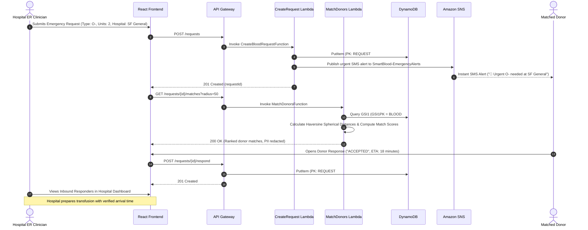

# SmartBlood – Final Architecture Specification
**AWS Weekend Challenge – No Pipeline, No Problem**

---

## 1. System Overview

**SmartBlood** is an intelligent, high-availability, zero-maintenance serverless healthcare platform engineered to solve critical hospital blood shortages by matching emergency requests with compatible, nearby donors within seconds.

Built entirely on AWS serverless primitives, SmartBlood achieves sub-second donor discovery, fan-out emergency SMS alerting, and live inventory telemetry without maintaining persistent EC2 servers, virtual machines, or idle container clusters.

```mermaid
flowchart TD
    subgraph ClientTier["Client Tier (Global Edge Distribution)"]
        Browser["React 18 + Vite SPA"]
        CloudFront["Amazon CloudFront CDN (Global Edge Caching + SSL)"]
        S3Bucket["Amazon S3 Bucket (Static Web Assets)"]
        Browser -->|"HTTPS / TLS 1.3"| CloudFront
        CloudFront -->|"Origin Fetch"| S3Bucket
    end

    subgraph SecurityTier["Identity, Access & Verification"]
        CognitoUP["Amazon Cognito User Pool"]
        CognitoClient["Cognito App Client"]
        CognitoAuth["API Gateway Cognito JWT Authorizer"]
        Browser -.->|"Authenticate / SRP"| CognitoUP
        CognitoUP -.->|"Issue JWT Token"| Browser
        Browser -->|"Bearer JWT Token"| CognitoAuth
    end

    subgraph IngestionTier["API Management Tier"]
        APIGW["Amazon API Gateway (REST API / CORS / Rate Limiting)"]
        CognitoAuth --> APIGW
    end

    subgraph ComputeTier["Compute Layer (AWS Lambda - Node.js 20 on ARM64)"]
        RegisterDonorFn["RegisterDonorFunction"]
        GetDonorProfileFn["GetDonorProfileFunction"]
        UpdateAvailabilityFn["UpdateDonorAvailabilityFunction"]
        CreateRequestFn["CreateBloodRequestFunction"]
        GetRequestsFn["GetBloodRequestsFunction"]
        GetRequestDetailsFn["GetBloodRequestDetailsFunction"]
        RespondToRequestFn["RespondToRequestFunction"]
        MatchDonorsFn["MatchDonorsFunction"]
        SendAlertFn["SendAlertFunction"]
        GetInventoryFn["GetInventoryFunction"]
        UpdateInventoryFn["UpdateInventoryFunction"]

        APIGW -->|POST /donors| RegisterDonorFn
        APIGW -->|GET /donors/{id}| GetDonorProfileFn
        APIGW -->|PUT /donors/{id}/availability| UpdateAvailabilityFn
        APIGW -->|POST /requests| CreateRequestFn
        APIGW -->|GET /requests| GetRequestsFn
        APIGW -->|GET /requests/{id}| GetRequestDetailsFn
        APIGW -->|POST /requests/{id}/respond| RespondToRequestFn
        APIGW -->|GET /requests/{id}/matches| MatchDonorsFn
        APIGW -->|POST /notifications/broadcast| SendAlertFn
        APIGW -->|GET /bloodbanks/{id}/inventory| GetInventoryFn
        APIGW -->|PUT /bloodbanks/{id}/inventory| UpdateInventoryFn
    end

    subgraph DataStorageTier["Persistence & Messaging Tier"]
        DynamoDB[("Amazon DynamoDB (Single Table Design)")]
        SNSTopic["Amazon SNS (SmartBlood-EmergencyAlerts)"]

        RegisterDonorFn --> DynamoDB
        GetDonorProfileFn --> DynamoDB
        UpdateAvailabilityFn --> DynamoDB
        CreateRequestFn --> DynamoDB
        CreateRequestFn -->|"Publish Alert"| SNSTopic
        GetRequestsFn --> DynamoDB
        GetRequestDetailsFn --> DynamoDB
        RespondToRequestFn --> DynamoDB
        MatchDonorsFn --> DynamoDB
        SendAlertFn --> SNSTopic
        GetInventoryFn --> DynamoDB
        UpdateInventoryFn --> DynamoDB
    end

    subgraph AlertDeliveryTier["Emergency Fan-Out"]
        SMS["SMS to Nearby Donors"]
        Email["Email to Blood Bank Response Teams"]
        SNSTopic --> SMS
        SNSTopic --> Email
    end
```

---

## 2. Component Breakdown

| Layer | Service | Configuration | Purpose |
| :--- | :--- | :--- | :--- |
| **Hosting & CDN** | Amazon S3 + CloudFront | Static hosting bucket with CloudFront Origin Access Identity (OAI), TLS 1.3, Brotli/Gzip compression | Hosts compiled React SPA with sub-50ms global latency and automated SSL certificate management |
| **Authentication** | Amazon Cognito | User Pool with custom attributes (`custom:bloodType`, `custom:userRole`), SRP auth flow | Issues cryptographically signed RS256 JWT tokens with role-based access for Donors and Hospital Staff |
| **API Management** | Amazon API Gateway | REST API with CORS headers, default Cognito JWT authorizer, regional endpoint, rate-limiting (10,000 req/sec) | Ingests all client traffic, performs request validation, and routes to respective microservice Lambdas |
| **Compute** | AWS Lambda | Node.js 20.x on Graviton2 (ARM64), 256MB memory, 15-second timeout | Event-driven compute that cold-starts in <100ms and scales to zero when idle |
| **Database** | Amazon DynamoDB | On-Demand (PAY_PER_REQUEST), Single Table Design, GSI1, Point-In-Time Recovery (PITR), KMS Encryption | Stores all donors, emergency requests, inventory counts, and donor arrival responses with single-digit millisecond latency |
| **Emergency Alerts** | Amazon SNS | Standard Pub/Sub Topic with MessageAttributes filtering (`bloodType`, `urgencyLevel`) | High-throughput fan-out alert broadcasting to registered mobile phones and hospital communication channels |

---

## 3. Data Flow & Intelligent Matching Lifecycle



---

## 4. DynamoDB Single-Table Design

```text
Table: SmartBlood-{Stage}
Billing: PAY_PER_REQUEST (On-Demand)
Partition Key: PK (String)
Sort Key:      SK (String)
GSI1 PK:       GSI1PK (String)
GSI1 SK:       GSI1SK (String)
```

| Entity | PK | SK | GSI1PK | GSI1SK | Attributes |
| :--- | :--- | :--- | :--- | :--- | :--- |
| **Donor Profile** | `DONOR#<donorId>` | `PROFILE` | `BLOOD#<bloodType>` | `STATUS#<AVAILABLE\|UNAVAILABLE>` | `name`, `email`, `phone`, `city`, `location: {lat, lon}`, `isAvailable`, `createdAt` |
| **Blood Request** | `REQUEST#<requestId>` | `DETAILS` | `BLOOD#<bloodType>` | `STATUS#<PENDING\|FULFILLED>` | `hospitalName`, `requesterName`, `bloodType`, `unitsNeeded`, `urgencyLevel`, `city`, `contactPhone`, `responsesCount` |
| **Donor Response** | `REQUEST#<requestId>` | `RESPONSE#<donorId>` | `DONOR#<donorId>` | `RESPONSE#<requestId>` | `donorName`, `bloodType`, `status: ACCEPTED`, `etaMinutes`, `notes`, `createdAt` |
| **Blood Bank Inventory** | `BANK#<bankId>` | `INVENTORY#<bloodType>` | `BANK#<bankId>` | `INVENTORY` | `bankName`, `bloodType`, `unitsAvailable`, `minSafeUnits`, `lastRestockedAt` |

---

## 5. Security & Privacy Controls
1. **Zero Credential Exposure**: No IAM keys or credentials are baked into client code or committed to Git. Functions assume fine-grained IAM execution roles generated by AWS SAM.
2. **Donor PII Redaction**: The public matching endpoint (`/requests/{id}/matches`) explicitly withholds raw emails, telephone numbers, and street-level coordinates. Only masked display names (e.g. `Marcus V.`), blood types, and computed spherical distances are exposed.
3. **Explicit Notification Consent**: Donor registration requires affirmative opt-in consent for emergency SMS dispatch.
4. **Data at Rest & Transit**: KMS encryption enabled by default on DynamoDB; all API and static hosting traffic is enforced over TLS 1.3.

---

## 6. Medical Safety Disclaimer
> [!IMPORTANT]
> **Clinical Pre-Transfusion Verification:**
> SmartBlood is an automated emergency logistics and discovery coordination platform. Attending clinicians and certified transfusion medicine pathologists must independently perform regulatory ABO/Rh blood grouping confirmation, antibody screening, and serological cross-matching prior to any clinical blood administration.
