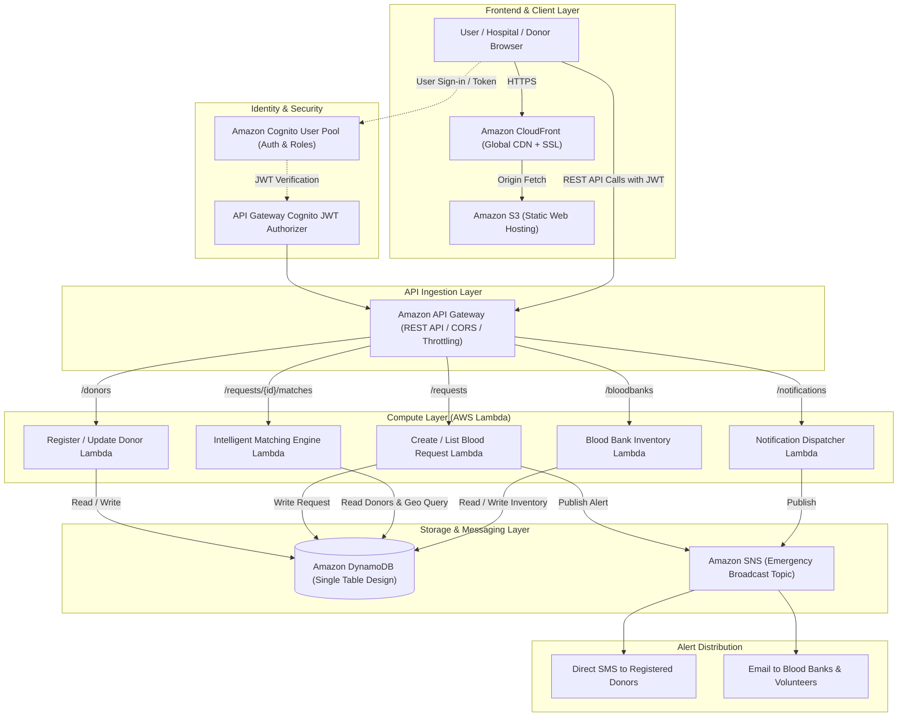
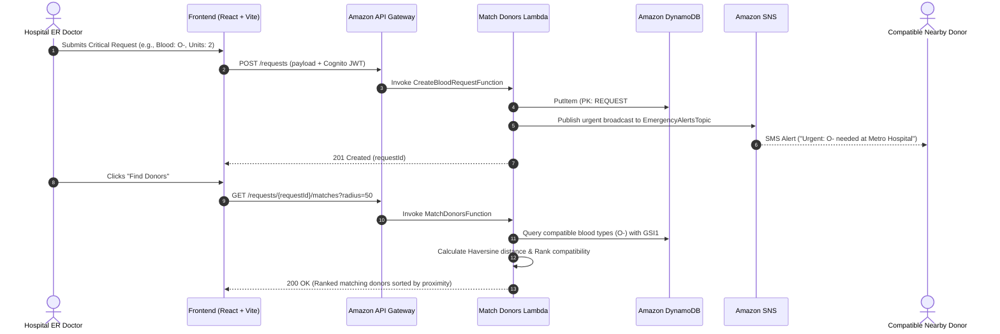

# SmartBlood – Cloud Architecture Documentation
**AWS Weekend Challenge – No Pipeline, No Problem**

## 1. Executive Summary
SmartBlood is an intelligent, high-availability, fully serverless healthcare application that matches emergency hospital blood shortages with compatible, geographically proximate donors in real time.

By utilizing AWS Serverless primitives, the platform operates with **zero idle server cost**, scales automatically to handle traffic spikes during regional disasters, and guarantees sub-second emergency response times.

---

## 2. AWS Serverless Architecture Diagram

---

## 3. Component Deep Dive

| Component | AWS Service | Purpose & Justification |
| :--- | :--- | :--- |
| **Static Hosting & CDN** | Amazon S3 + Amazon CloudFront | Delivers Vite + React Single Page Application (SPA) globally with low latency, edge caching, and automated HTTPS certificate provisioning via ACM. |
| **Identity & Authentication** | Amazon Cognito | Secure user management, role-based access control (`DONOR`, `HOSPITAL_ADMIN`, `BLOOD_BANK_MANAGER`), token refresh, and phone verification. |
| **API Management** | Amazon API Gateway (REST) | Handles routing, CORS negotiation, request throttling, automated request validation, and Cognito JWT authorizer verification. |
| **Serverless Compute** | AWS Lambda (Node.js 20) | Modular, event-driven functions running on Graviton2 (ARM64) for optimal cost-performance and sub-100ms execution times. |
| **Primary Database** | Amazon DynamoDB | Fully managed NoSQL database using Single Table Design, sub-10ms latency, automatic pay-per-request scaling, and point-in-time recovery. |
| **Notification Engine** | Amazon SNS | Fan-out pub/sub emergency broadcasting service alerting donors and medical staff instantly via SMS and email. |

---

## 4. Intelligent Matching Engine Workflow

---

## 5. Security & Compliance
- **Zero Exposed Secrets**: All AWS credentials remain in IAM roles attached to Lambdas; frontend communicates solely through Cognito tokens and API Gateway endpoints.
- **Least Privilege IAM**: Every Lambda function has isolated IAM permissions generated by SAM policies (`DynamoDBCrudPolicy`, `SNSPublishMessagePolicy`).
- **Data Protection at Rest & Transit**:
  - DynamoDB uses AWS KMS Server-Side Encryption (SSE).
  - All communication happens over TLS 1.3.
- **Rate Limiting & DDoS Prevention**: API Gateway built-in throttling prevents denial-of-service abuse.

